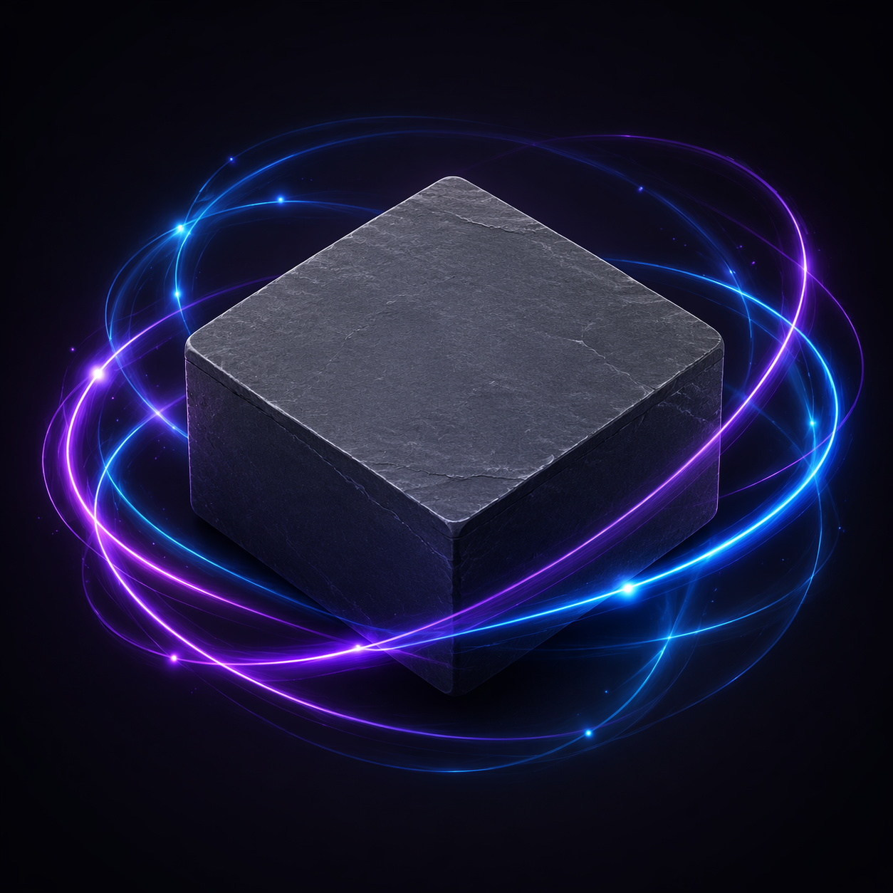

# slatebox

[](https://github.com/nblair2/slatebox/releases/latest)
[](https://github.com/nblair2/slatebox/actions/workflows/build.yml)
[](https://github.com/nblair2/slatebox/blob/main/LICENSE)
[](https://developer.hashicorp.com/packer)
[](https://ubuntu.com/server)

> "Have you ever had a dream, Neo, that you were so sure was real? … How would you know the difference between the dream world and the real world?”
> - Morpheus, *The Matrix*

**`slatebox` is an internet simulator in a VM.** It is a "clean slate" implementation of CMU-SEI's excellent [`greybox`](https://github.com/cmu-sei/greybox) tool.



## Quick start

```sh
git clone https://github.com/nblair2/slatebox.git
cd slatebox
make build
```

The image is written to `output/slatebox.qc2`. See [Build](build.md) for settings.

## License

Original code and modifications are [GPL-3.0-or-later](https://github.com/nblair2/slatebox/blob/main/LICENSE).

Derived material comes from CMU-SEI's [greybox](https://github.com/cmu-sei/greybox/tree/e89c3754491db97599db073bbeb18fc7b20a7240) and [topgen](https://github.com/cmu-sei/topgen/tree/e0ab5441a860a98fce4a49c249fe9b61a0e56747), Copyright 2016 Carnegie Mellon University. Their [greybox](https://github.com/nblair2/slatebox/blob/main/LICENSE.greybox) and [topgen](https://github.com/nblair2/slatebox/blob/main/LICENSE.topgen) licenses and Government Purpose Rights notices are preserved in `/usr/local/share/doc/slatebox/` in the image. Bundled software and content retain their own licenses. Redistribution must include required notices and source.
