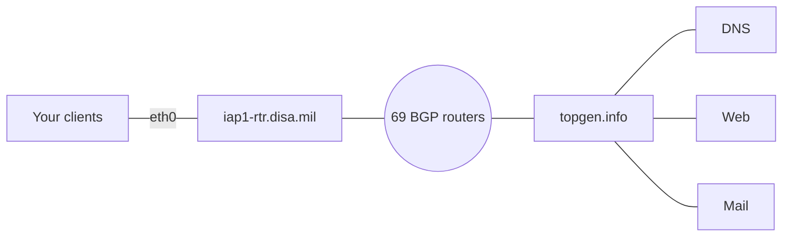
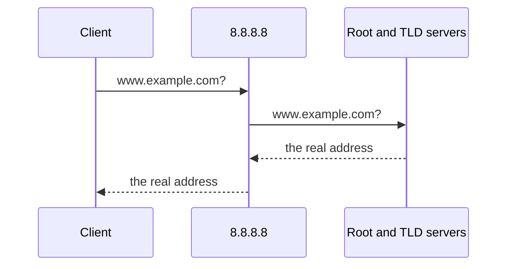

# Services

slatebox runs a small internet inside one VM. [CORE](https://github.com/coreemu/core) emulates
the network. TopGen provides the services on one node, `topgen.info`.

Log in to the VM as `root` with the password `slatebox`.



| Service | Software | What it does |
|---|---|---|
| Backbone | CORE, FRR | 69 routers that exchange routes with BGP |
| DHCP | `iap1-rtr.disa.mil` | Gives your clients an address, gateway and DNS server |
| DNS | BIND9 | Root, TLD and caching servers |
| Web | nginx | Serves the mirrored sites over HTTPS |
| Mail | Postfix, Dovecot | A mail server for each `mail_sites` entry |
| Certificates | TopGen CA | Signs a certificate for every mirrored site |

## Network

Connect your clients to the first NIC of the VM, `eth0`. They get these settings from DHCP.
Every other NIC of the VM gets its own address by DHCP.

| Setting | Value |
|---|---|
| Network | `12.0.0.0/24` |
| Gateway | `12.0.0.41` |
| DNS | `8.8.8.8` |
| DHCP pool | `12.0.0.100` to `12.0.0.250` |

The network starts at boot. Routing needs a few minutes to converge.

```sh
greybox-ctl status
systemctl restart greybox
```

## DNS

BIND9 runs root, TLD and caching servers. A mirrored site resolves to the address it had on the
real internet.



Add your own records to `/etc/topgen/hosts.custom`, one `IP name` on each line.

## Web

nginx on `topgen.info` holds the address of every mirrored site. It serves each site over HTTP
and HTTPS with a certificate from the TopGen CA.

`https://topgen.info/` lists the mirrored sites.

## Mail

Each mail server offers these ports. Each has the account `administrator` with the password
`password` by default.

| Port | Use |
|---|---|
| 25 | SMTP between servers |
| 587 | Submission with STARTTLS |
| 993 | IMAPS |

The default server addresses are stored in `/var/lib/topgen/etc/vmail.cfg`.
Add custom servers and accounts to `/etc/topgen/vmail.cfg`. Each line is a server, its address, then
`user:password` pairs. Give each domain an address of its own.
Custom injects overwrite defaults if they clash.

```text
mail.example.com 203.0.113.25 jdoe:Summer2026 asmith:Winter2026 operator:operator
mail.site.net 203.0.113.26 helpdesk:changeme billing:invoice123
```


Mail lands on the VM in `/var/lib/topgen/vmail`. Each account has a Maildir at
`/var/lib/topgen/vmail/<domain>/<user>`.
An account reads its mail with any IMAP client. Connect to its server on port 993 with TLS. Log
in with the user name and password. The server picks the domain from the address you connect
to. Its certificate is for `imap.topgen.info`.
Mail to an unknown user of a mail domain lands in the catch all. It is one mbox file for every
domain, `/var/lib/topgen/vmail/DFLT`.

## Certificates

A CA made at build time signs every mirrored site.

| Item | Location |
|---|---|
| CA certificate | `/var/lib/topgen/etc/topgen_ca.cer` |
| CRL | `http://topgen.info/topgen_ca.crl` |

Your clients must trust the CA certificate. To use your own CA, set `overlay_dir`. Put
the key at `var/lib/topgen/etc/topgen_ca.key` and the certificate at
`var/lib/topgen/etc/topgen_ca.cer` in that directory.
